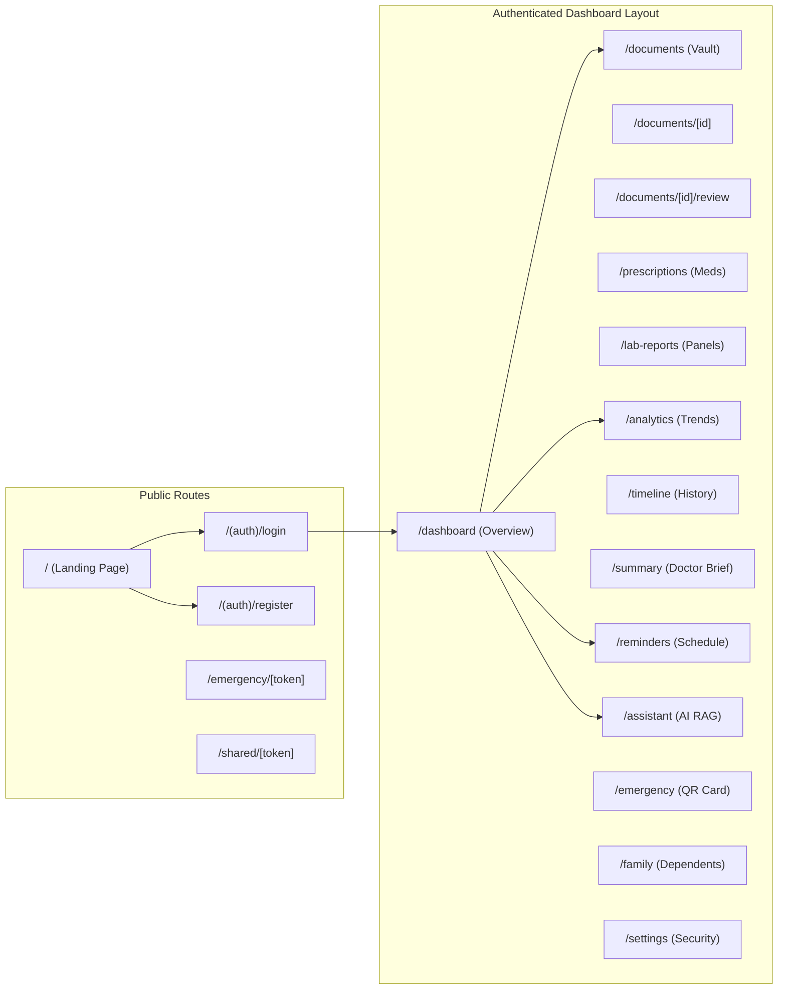
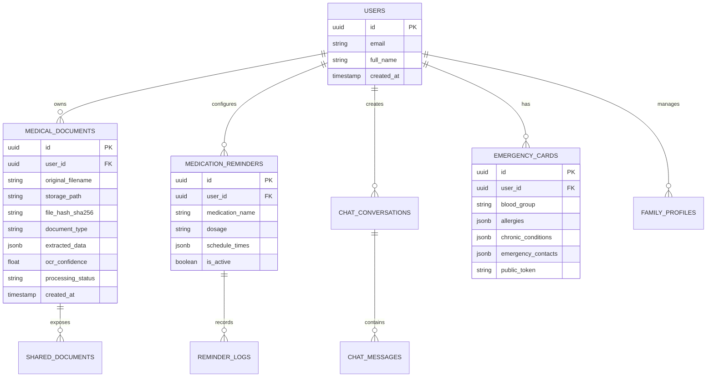
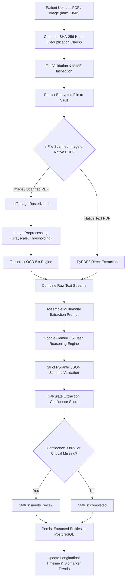
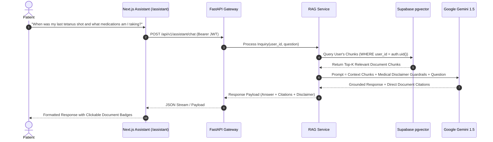

# HealthSync AI — Comprehensive Project Architecture & Technical Specification

> **Confidential & Proprietary** | **Document Version:** 1.0.0 | **Generated:** November 2026  
> **Repository:** `HealthSync-AI` | **Author:** HealthSync Engineering Team

---

## Table of Contents

1. [Executive Summary & Clinical Mission](#1-executive-summary--clinical-mission)
2. [System Architecture Overview](#2-system-architecture-overview)
3. [Technology Stack Matrix](#3-technology-stack-matrix)
4. [Backend Architecture & Services](#4-backend-architecture--services)
5. [Complete API Endpoints Catalog](#5-complete-api-endpoints-catalog)
6. [Frontend Architecture & Page Catalog](#6-frontend-architecture--page-catalog)
7. [Database Schema, PostgreSQL & Row-Level Security (RLS)](#7-database-schema-postgresql--row-level-security-rls)
8. [Multimodal OCR & AI Extraction Pipeline](#8-multimodal-ocr--ai-extraction-pipeline)
9. [Clinical RAG (Retrieval-Augmented Generation) Architecture](#9-clinical-rag-retrieval-augmented-generation-architecture)
10. [Security, Compliance & HIPAA Alignment](#10-security-compliance--hipaa-alignment)
11. [Configuration & Environment Variables](#11-configuration--environment-variables)
12. [Local Setup, Execution & Testing Runbook](#12-local-setup-execution--testing-runbook)

---

## 1. Executive Summary & Clinical Mission

### 1.1 Project Purpose
**HealthSync AI** is a state-of-the-art, patient-centric personal health records (PHR) and clinical document intelligence platform. It bridges the gap between fragmented medical paper trails and patient health literacy by ingesting physical prescriptions, clinical visit summaries, lab analyte sheets, and diagnostic imaging reports, transforming them into a structured, longitudinal health record.

### 1.2 Core Value Propositions
* **Zero-Hallucination Extraction**: Calibrated multi-stage multimodal parsing (Tesseract OCR combined with Google Gemini Multimodal Vision) to extract clinical entities with explicit confidence scoring.
* **Longitudinal Biomarker Tracking**: Extraction and plotting of biological analytes (e.g., Fasting Plasma Glucose, HbA1c, Total Serum Cholesterol, Creatinine) over time.
* **Unified Chronological Timeline**: Centralized aggregation of all clinical episodes, appointments, prescriptions, and lab investigations.
* **Emergency Medical QR Access**: Instant access to critical blood type, known allergies, chronic conditions, and emergency contacts via encrypted public token links without requiring account sign-in.
* **Physician Pre-Visit Summary & PDF Generation**: Automated synthesis of health records into standardized clinical PDF briefings tailored for specialized physicians.
* **Isolated Multi-Tenant Clinical Assistant**: A RAG-powered chatbot with strict medical disclaimer guardrails and zero-crossover patient privacy.

### 1.3 Strict Medical Disclaimer
```
DISCLAIMER: HealthSync AI organizes, retrieves, and explains information from existing medical records.
It NEVER diagnoses diseases, recommends clinical treatments, or prescribes medications.
All health evaluations and clinical interventions require consultation with licensed healthcare professionals.
```

---

## 2. System Architecture Overview

HealthSync AI employs a decoupled, cloud-ready client-server architecture composed of a Next.js 15 front-end application, a FastAPI asynchronous Python microservice backend, and a Supabase managed PostgreSQL database with Row-Level Security (RLS).

### 2.1 High-Level Architecture Diagram

```mermaid
graph TD
    Client["Next.js 15 Web Application (React 19 / Tailwind / Aceternity UI)"]
    API["FastAPI Asynchronous Gateway (/api/v1)"]
    Auth["Supabase Auth (JWT HMAC-SHA256)"]
    DB[("Supabase PostgreSQL (RLS / pgvector)")]
    OCR["OCR Pipeline (Tesseract 5.x / PyPDF2 / pdf2image)"]
    LLM["Google Gemini 1.5 Multimodal Engine"]
    Storage["Supabase Encrypted Object Storage / Local Vault"]

    Client -->|HTTPS / REST / JWT| API
    Client -->|Auth Handshake| Auth
    API -->|Verify Token & Identity| Auth
    API -->|Tenant-Isolated Queries (RLS)| DB
    API -->|Raw Document Ingestion| Storage
    API -->|Multi-pass Extraction| OCR
    OCR -->|Vision & Reasoning Prompts| LLM
    API -->|Embeddings & Semantic Search| DB
```

---

## 3. Technology Stack Matrix

| Layer | Technology | Version | Purpose |
| :--- | :--- | :--- | :--- |
| **Frontend Framework** | Next.js (App Router) | `15.5.x` | Modern server-rendered & client-interactive UI architecture |
| **Frontend Runtime** | React & React DOM | `19.x` | Reactive UI component state & rendering |
| **Styling & Design System** | Tailwind CSS & UI/UX Pro Max | `3.4.x` | Modern, responsive, accessible design with clinical teal/slate palette |
| **UI Components** | Aceternity UI, Radix UI primitives | Latest | Bento grids, moving borders, card spotlights, animated modals |
| **Icons & Visuals** | Lucide React | `^1.16.0` | Accessible, consistent iconography |
| **Data Visualization** | Recharts | `^3.7.0` | Interactive longitudinal biomarker trend charts & analyte timelines |
| **Backend Framework** | FastAPI | `^0.115.0` | High-performance asynchronous Python REST API gateway |
| **ASGI Server** | Uvicorn | `^0.34.0` | Async server implementation with hot-reloading |
| **Data Validation** | Pydantic v2 & Pydantic-Settings | `^2.10.0` | Strict data schema parsing, validation, and serialization |
| **Database & Vector Store** | PostgreSQL via Supabase | `15+` | Relational persistence with `pgvector` extension for clinical embeddings |
| **Auth Provider** | Supabase GoTrue Auth | `v2` | Cryptographic JWT verification with Row-Level Security integration |
| **OCR Engines** | Tesseract OCR & PyTesseract | `5.x` / `0.3.13` | Optical Character Recognition on scanned PDF/PNG/JPG documents |
| **PDF Processing** | PyPDF2, pdf2image, Pillow (PIL) | Latest | PDF rasterization, text extraction, image sanitization |
| **PDF Generation** | ReportLab | `^4.3.0` | Server-side cryptographic generation of Doctor Visit Summaries |
| **AI / Multimodal LLM** | Google Gemini 1.5 Flash / Pro | Official SDK | Multimodal document parsing, entity extraction, clinical RAG assistant |

---

## 4. Backend Architecture & Services

The backend follows clean architectural patterns: clear separation between Transport (API Routes), Schemas (Pydantic), Domain Services, Storage, and Infrastructure.

```
backend/
├── app/
│   ├── api/
│   │   ├── router.py                  # Master API v1 router mounting all sub-routes
│   │   └── routes/
│   │       ├── auth.py                # Registration, Login, Session, Profile
│   │       ├── documents.py           # Document ingestion, OCR, download, review
│   │       ├── intelligence.py        # Timeline, Trends, Summaries, QR Emergency, Family
│   │       ├── reminders.py           # Medication reminder schedules & adherence logging
│   │       ├── assistant.py           # Contextual RAG Chat & conversation history
│   │       └── health.py              # System health, memory, database readiness checks
│   ├── core/
│   │   ├── auth.py                    # JWT decoding, Supabase verification, Demo Fallback
│   │   ├── config.py                  # Pydantic BaseSettings environment configuration
│   │   ├── db.py                      # Database connection pool & session manager
│   │   ├── demo_data.py               # Pre-seeded sandbox data for instant exploration
│   │   ├── exceptions.py              # Standardized API error responses & exceptions
│   │   ├── logger.py                  # Structured audit and operational logging
│   │   └── supabase_client.py         # Lazy-loaded Supabase Python SDK client
│   ├── models/
│   │   └── entities.py                # Database entity definitions & ORM bindings
│   ├── schemas/
│   │   ├── auth.py                    # Auth request & response schemas
│   │   ├── document.py                # Clinical document extraction schemas
│   │   ├── intelligence.py            # Trends, timeline, sharing, emergency schemas
│   │   ├── reminders.py               # Medication & adherence schemas
│   │   └── assistant.py               # Chat query, message, context schemas
│   ├── services/
│   │   ├── auth_service.py            # User identity & role management
│   │   ├── document_service.py        # File validation, SHA-256 deduplication, lifecycle
│   │   ├── ocr_service.py             # Tesseract multi-pass OCR & image preprocessing
│   │   ├── extractor_service.py       # Clinical entity extraction with confidence scores
│   │   ├── classifier_service.py      # Rule-based & LLM document type categorization
│   │   ├── intelligence_service.py    # Analyte trends, timeline aggregation, PDF reports
│   │   ├── reminder_service.py        # Cron scheduler, dosage tracking, daily reminders
│   │   ├── rag_service.py             # Tenant-isolated semantic search & LLM answering
│   │   ├── pdf_service.py             # ReportLab PDF synthesis for physician summaries
│   │   ├── storage_service.py         # Multi-backend document storage (Supabase / Local)
│   │   ├── audit_service.py           # HIPAA audit trail logging for document access
│   │   └── llm/
│   │       ├── base.py                # Abstract LLM provider interface
│   │       ├── gemini_provider.py     # Gemini 1.5 Flash / Pro provider implementation
│   │       └── factory.py             # Provider instantiation factory
│   └── utils/
│       ├── file_handler.py            # Safe path resolution & MIME inspection
│       └── file_security.py           # Cryptographic hashing & virus scanning stubs
├── migrations/                        # SQL migration scripts (001 to 007)
├── tests/                             # Comprehensive pytest suite
└── main.py                            # FastAPI application factory & middleware setup
```

---

## 5. Complete API Endpoints Catalog

All API endpoints are prefixed with `/api/v1` and enforce HTTPS and Bearer JWT authentication (except public share and emergency endpoints).

### 5.1 Authentication Routes (`/api/v1/auth`)
* `POST /register`: Registers a new user account via Supabase Auth.
* `POST /login`: Authenticates credentials and returns cryptographic access token & session metadata.
* `POST /logout`: Invalidates the user session and logs audit event.
* `GET /me`: Returns the verified user profile (email, name, role, date of birth).
* `PUT /profile`: Updates editable user metadata.

### 5.2 Document Management Routes (`/api/v1/documents`)
* `POST /upload`: Ingests a medical file (PDF/PNG/JPG, max 10MB), checks SHA-256 duplicate hash, triggers OCR & AI extraction pipeline, and persists structured entities.
* `GET /`: Lists paginated documents with filtering by category, status, and search keywords.
* `GET /{document_id}`: Retrieves full document metadata and extracted clinical JSON.
* `GET /{document_id}/download`: Streams the decrypted original file attachment.
* `PATCH /{document_id}/review`: Accepts human-reviewed edits to clinical entities, updating confidence scores.
* `DELETE /{document_id}`: Permanently deletes the document and unlinks related reminders/timeline entries.

### 5.3 Advanced Intelligence Routes (`/api/v1/intelligence`)
* `GET /timeline`: Aggregates all clinical records into a chronological feed with category filtering and keyword search.
* `GET /analytics/trends`: Extracts historical biological analytes (Glucose, HbA1c, Cholesterol, etc.) across lab reports, formatting them for Recharts graphing.
* `POST /summary/preview`: Generates a real-time Markdown preview of a doctor visit briefing based on selected records.
* `POST /summary/pdf`: Synthesizes and streams an official, downloadable clinical PDF report using ReportLab.
* `POST /shares`: Creates a time-limited, encrypted public share token for specific documents (e.g., sharing a lab report with a specialist).
* `GET /shares`: Lists all active public share tokens generated by the user.
* `DELETE /shares/{token}`: Revokes an active public share token immediately.
* `GET /shares/public/{token}`: **[PUBLIC]** Allows a physician or third party to view shared documents without logging in.
* `GET /emergency`: Retrieves or generates the user's permanent Emergency QR Medical Profile.
* `PUT /emergency`: Updates blood group, allergies, chronic conditions, and emergency contacts.
* `POST /emergency/rotate`: Invalidates the existing emergency token and issues a new QR code.
* `GET /emergency/public/{token}`: **[PUBLIC]** Emergency responders scan the physical QR code to immediately view life-saving medical data.
* `POST /family`: Creates a dependent family member profile (child, elderly parent).
* `GET /family`: Lists all managed family member profiles under the user's account.
* `DELETE /family/{profile_id}`: Removes a family profile.
* `POST /briefing`: Generates a specialized pre-visit doctor briefing (Cardiology, Endocrinology, General Practice).

### 5.4 Medication Reminders (`/api/v1/reminders`)
* `GET /`: Lists all active and inactive medication schedules.
* `GET /today`: Returns medications scheduled for the current calendar day with completion flags.
* `POST /`: Creates a medication schedule (medication name, dosage, frequency, times of day).
* `PATCH /{reminder_id}`: Updates dosage, instructions, or active status.
* `POST /{reminder_id}/log`: Logs adherence status (`taken`, `skipped`, `missed`) for a specific scheduled dose.
* `DELETE /{reminder_id}`: Deletes a medication reminder schedule.

### 5.5 Clinical AI Assistant (`/api/v1/assistant`)
* `POST /chat`: Submits a clinical inquiry to the tenant-isolated RAG engine, retrieving relevant document chunks and generating an answer accompanied by citations and medical disclaimers.
* `GET /conversations`: Retrieves historical chat session threads.
* `GET /conversations/{conversation_id}`: Returns message history for a specific thread.
* `DELETE /conversations/{conversation_id}`: Clears chat thread history.

### 5.6 Health & Readiness (`/health`)
* `GET /health`: Returns system uptime, database connection readiness, OCR availability, and LLM configuration status.

---

## 6. Frontend Architecture & Page Catalog

Built with Next.js 15 App Router, React 19, Tailwind CSS, Aceternity UI, and custom UI components following the UI/UX Pro Max clinical design guidelines.



### 6.1 Complete Page Catalog

#### 1. Landing Page (`frontend/src/app/page.tsx`)
* **Hero Section**: 2-column balanced SaaS presentation.
  * *Left Column*: Clean typography ("Your Records In Order"), clinical tagline ("Your Health. Connected. Intelligent. Organized."), description ("All your medical records, neatly organised in one place."), and 4 capability cards.
  * *Right Column*: Action portal card with "Get Started Free", "Instant Demo (Alex Morgan)", and "Sign In / Go to Dashboard".
* **Interactive Feature Showcase**:
  * *Left Navigation*: 4 vertically stacked buttons (*Prescription Intelligence*, *Lab Biomarker Analytics*, *Emergency QR Profile*, *Isolated RAG Assistant*).
  * *Right Display Card*: Real-time interactive previews of extracted prescriptions, CMP analyte tables, emergency QR cards, and AI consultation cards.
* **The Healthcare Reality**: 3-stage challenge-solution breakdown (Scattered Records, Unclear Terminology, Emergency Blindspots).
* **Bento Grid Architecture**: Aceternity UI Bento Grid illustrating OCR accuracy, zero data leakage, and encrypted storage.
* **Security & FAQ Section**: Comprehensive answers to HIPAA compliance, data isolation, and encryption questions.

#### 2. Authentication Pages (`frontend/src/app/(auth)/login` & `register`)
* **Features**: Email/password authentication, client-side validation, password strength meters, demo-mode 1-click bypass button ("Explore Instant Demo as Alex Morgan"), and clear error states.

#### 3. Patient Overview Dashboard (`frontend/src/app/(dashboard)/dashboard/page.tsx`)
* **Header & Quick Stats**: Document counts, active prescriptions, pending reviews, and today's medication adherence.
* **Today's Medication Tracker**: Direct interactive checkboxes to mark daily morning/afternoon/night medications as taken.
* **Recent Records Feed**: Filterable document table with OCR status, entity tags, and direct access links.
* **Quick Action Modals**: Fast upload, ask AI assistant shortcut, and view emergency QR card.

#### 4. Medical Documents Vault (`frontend/src/app/(dashboard)/documents/page.tsx`)
* **Features**: Drag-and-drop file upload modal supporting multi-page PDF, PNG, and JPG.
* **Table & Grid Views**: Search by document title, doctor, facility, or clinical category. Filter by processing status (`completed`, `processing`, `needs_review`).
* **Detail & Human Review Pages (`[id]/page.tsx` & `[id]/review/page.tsx`)**: Split-screen interface showing the original scanned document on the left and extracted structured clinical entities on the right, allowing patients to correct or verify extracted data.

#### 5. Prescription Intelligence (`frontend/src/app/(dashboard)/prescriptions/page.tsx`)
* **Features**: Aggregates all parsed prescriptions across all uploaded clinic visits. Displays medication names, active ingredients, dosage strengths, frequencies, duration, prescribing physicians, and refill alerts.

#### 6. Lab Reports & Biomarker Analytics (`/lab-reports` & `/analytics`)
* **Lab Reports**: Lists extracted laboratory panels (Comprehensive Metabolic Panels, Lipid Panels, Complete Blood Counts) with analyte counts.
* **Biomarker Analytics (`/analytics`)**: Interactive Recharts time-series line and area charts plotting longitudinal analyte values against standard clinical reference ranges (Normal, Optimal, Slightly High, Critical).

#### 7. Unified Medical Timeline (`frontend/src/app/(dashboard)/timeline/page.tsx`)
* **Features**: Chronological vertical timeline connecting consultations, prescriptions, lab draws, and imaging over months and years. Supports date-range filtering and instant keyword search.

#### 8. Physician Pre-Visit Summary & PDF Export (`frontend/src/app/(dashboard)/summary/page.tsx`)
* **Features**: Patient selects which historical visits and lab panels to include, chooses the target medical specialty (e.g., Cardiology, General Practice), adds custom notes, previews the generated clinical synthesis, and downloads an official multi-page PDF briefing.

#### 9. Medication Reminders & Schedules (`frontend/src/app/(dashboard)/reminders/page.tsx`)
* **Features**: Create and customize medication schedules (times, frequency, food instructions). View daily schedule, log adherence (`taken`, `skipped`), and visualize monthly adherence percentage.

#### 10. Clinical AI Assistant (`frontend/src/app/(dashboard)/assistant/page.tsx`)
* **Features**: Chat interface powered by RAG. Patients can ask natural language questions ("What was my fasting glucose in August?", "What instructions did Dr. Smith give for my antibiotic?"). Displays source citations linking directly to verified documents.

#### 11. Emergency Medical QR Card (`frontend/src/app/(dashboard)/emergency/page.tsx`)
* **Features**: Displays digital medical ID card with blood type, primary allergies, chronic conditions, emergency contact numbers, and a live QR code. Includes token rotation button and public printable layout.

#### 12. Public Emergency View (`frontend/src/app/emergency/[token]/page.tsx`)
* **Features**: Publicly accessible, responsive medical alert card rendered when first responders scan the patient's QR code. Requires zero login, displaying critical life-saving information immediately.

#### 13. Family Profiles (`frontend/src/app/(dashboard)/family/page.tsx`)
* **Features**: Add, switch between, and manage health records for family members (dependents, children, elderly parents) within a single account.

#### 14. Settings & Security (`frontend/src/app/(dashboard)/settings/page.tsx`)
* **Features**: Profile information editing, notification preferences, session management, language selector (English, Spanish, Hindi), and privacy controls.

---

## 7. Database Schema, PostgreSQL & Row-Level Security (RLS)

The database schema is organized into modular migrations executed in order:



### 7.1 Row-Level Security (RLS) Enforcement
HealthSync AI implements strict PostgreSQL Row-Level Security on every patient table:
```sql
ALTER TABLE medical_documents ENABLE ROW LEVEL SECURITY;

CREATE POLICY "Patients can only access their own documents"
ON medical_documents
FOR ALL
USING (auth.uid() = user_id)
WITH CHECK (auth.uid() = user_id);
```
No query executed on behalf of one user can ever return, mutate, or delete data belonging to another user.

---

## 8. Multimodal OCR & AI Extraction Pipeline

When a medical document is uploaded, it passes through an asynchronous multi-stage pipeline:



### Extracted Entity Schema
* **Document Metadata**: Date of consultation, clinic/hospital name, physician name, document classification.
* **Prescription Items**: Drug brand name, generic name, strength, dosage form, instructions (e.g., "Take 1 tablet after meals"), refill count.
* **Laboratory Analytes**: Test name, numerical observed value, measurement units, biological reference range, abnormal flag (`NORMAL`, `HIGH`, `CRITICAL`).
* **Clinical Diagnoses & Notes**: Primary ICD description, clinical summary, follow-up instructions.

---

## 9. Clinical RAG (Retrieval-Augmented Generation) Architecture

The **Isolated RAG Assistant** allows patients to query their medical records conversationally while guaranteeing privacy and factual grounding.



### Guardrail System Prompt
The assistant operates under strict clinical boundaries:
1. Ground answers **strictly** in the user's provided document context.
2. State clearly when requested information is absent from uploaded records.
3. **Never** offer medical diagnoses, prognosis predictions, or self-medication recommendations.
4. Append the mandatory clinical disclaimer to every interaction.

---

## 10. Security, Compliance & HIPAA Alignment

HealthSync AI incorporates defense-in-depth security principles:

* **Tenant Isolation**: PostgreSQL Row-Level Security (RLS) ensures that database queries are constrained by `auth.uid() = user_id`.
* **Transport Security**: Enforced HTTPS/TLS 1.3 across all communication channels.
* **Cryptographic Token Verification**: HMAC SHA-256 JWT validation on every incoming request.
* **Malicious File Protection**: Strict MIME-type checking, file size bounds (10MB limit), and path traversal prevention (`os.path.abspath` sanitization).
* **Audit Trail Logging**: Structured security logs capture every authentication event, document upload, modification, share creation, and deletion with timestamps and user identifiers.
* **Emergency QR Privacy**: Emergency tokens are cryptographically randomized UUIDs that can be rotated or revoked by the patient at any moment.

---

## 11. Configuration & Environment Variables

All settings are managed via Pydantic BaseSettings in `backend/app/core/config.py`.

### Backend Configuration Reference (`backend/.env`)

| Variable Name | Type | Description |
| :--- | :--- | :--- |
| `PROJECT_NAME` | `str` | Application title (`"HealthSync AI"`) |
| `VERSION` | `str` | Semantic software version (`"0.1.0"`) |
| `ENVIRONMENT` | `str` | Runtime mode: `development`, `staging`, or `production` |
| `DEBUG` | `bool` | Enables verbose debug logging and traceback outputs |
| `HOST` | `str` | Server binding address (`"0.0.0.0"`) |
| `PORT` | `int` | Backend HTTP port (`8000`) |
| `API_V1_STR` | `str` | Base API route prefix (`"/api/v1"`) |
| `DEMO_MODE_ENABLED` | `bool` | Enables synthetic demo session fallback for sandbox exploration |
| `CORS_ORIGINS` | `list` | Allowed CORS origins (`["http://localhost:3000"]`) |
| `UPLOAD_DIR` | `str` | Local directory for document uploads (`"uploads"`) |
| `MAX_UPLOAD_SIZE_MB` | `int` | Maximum upload size threshold in Megabytes (`10`) |
| `TESSERACT_CMD` | `str` | Absolute path to Tesseract OCR binary executable |
| `LLM_PROVIDER` | `str` | Active LLM service (`"gemini"`) |
| `LLM_API_KEY` | `str` | Google Gemini API Key |
| `LLM_MODEL` | `str` | Target model name (`"gemini-1.5-flash"`) |
| `SUPABASE_URL` | `str` | Supabase project HTTPS URL |
| `SUPABASE_KEY` | `str` | Supabase anonymous / public API key |
| `SUPABASE_SERVICE_ROLE_KEY` | `str` | Supabase administrative service-role key (backend only) |
| `SUPABASE_STORAGE_BUCKET` | `str` | Storage bucket identifier for medical documents |

---

## 12. Local Setup, Execution & Testing Runbook

### 12.1 Prerequisites
* **Python**: Python 3.11 or higher
* **Node.js**: Node.js 18.x or 20.x+ with npm or pnpm
* **Tesseract OCR**: Installed and added to system path (or referenced via `TESSERACT_CMD`)

### 12.2 Backend Startup
```bash
# 1. Navigate to workspace root
cd HealthSync

# 2. Activate Python virtual environment
.\backend\venv\Scripts\activate   # Windows
# source backend/venv/bin/activate # macOS/Linux

# 3. Install dependencies
pip install -r backend/requirements.txt

# 4. Start FastAPI server with live reload
python -m uvicorn backend.main:app --host 127.0.0.1 --port 8000 --reload
```
*API Documentation Swagger UI available at:* `http://127.0.0.1:8000/docs`

### 12.3 Frontend Startup
```bash
# 1. Navigate to frontend directory
cd HealthSync/frontend

# 2. Install dependencies
npm install

# 3. Start Next.js development server
npm run dev
```
*Web Application available at:* `http://localhost:3000`

### 12.4 Verification & Testing
```bash
# Run backend test suite
pytest backend/tests

# Run frontend TypeScript type verification
npx --prefix frontend tsc --noEmit -p frontend/tsconfig.json
```

---

*HealthSync AI — Transforming Fragmented Clinical Records into Longitudinal Health Intelligence.*
