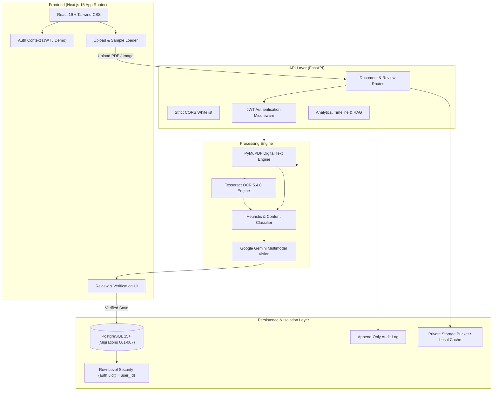

# HealthSync AI

> **AI-Powered Personal Health Record & Clinical Document Intelligence Platform**
> 
> *Organize, understand, and navigate your complete medical history—from handwritten prescriptions and lab panels to discharge summaries and imaging—in one secure, patient-owned vault.*

---

## ⚠️ Important Medical Disclaimer
**HealthSync AI is a personal health organization, document search, and summarization assistant.**
It **NEVER** diagnoses conditions, recommends medical treatments, or prescribes medications. All extracted clinical entities require patient review, and users should always consult a licensed medical professional for clinical advice.

---

## 📌 Problem Statement & Overview

Modern healthcare is fragmented. Patients visit multiple clinics, diagnostic labs, and specialists, collecting loose paper prescriptions, printed lab panels, and PDF discharge summaries. When emergencies occur or second opinions are needed:
- **Critical history is lost**: Crucial allergy notes, medication schedules, and past test results are scattered across physical folders.
- **Biomarker trends are invisible**: Spotting subtle increases in HbA1c, cholesterol, or creatinine across multiple years of PDF lab reports is nearly impossible by eye.
- **Doctors lack consolidated summaries**: Physicians have minutes to understand years of patient history during consultations.
- **Language barriers impair adherence**: Complex medical terminology creates patient confusion and missed doses.

**HealthSync AI** solves this by combining modern document processing (PyMuPDF + Tesseract OCR + Google Gemini Vision) with strict patient-isolated PostgreSQL Row-Level Security (RLS) to build a unified, intelligent health timeline with interactive trend analytics, medication reminders, emergency QR access, and verified clinical review.

---

## ✨ Key Features

- 📑 **Multimodal Document Processing**: Upload scanned images (PNG, JPEG) or digital PDFs. Extracts text via PyMuPDF or Tesseract OCR 5.4, and derives structured clinical entities via Google Gemini Multimodal Vision or deterministic rule extractors.
- 🩺 **Human-in-the-Loop Verification**: Calibrated confidence scoring highlights low-confidence fields for patient or clinician review before saving.
- 💊 **Prescription & Medication Tracking**: Automatically extracts drug names, dosages, frequencies, and durations with schedule generation and one-tap adherence logging.
- 🧪 **Lab Panel Analytics & Biomarker Trends**: Automatically parses lab reports into structured biomarker tables, flags abnormal results (`NORMAL`, `HIGH`, `LOW`, `CRITICAL`), and charts longitudinal trends using Recharts.
- 📅 **Chronological Health Timeline**: Unified chronological view across all doctor visits, medications, tests, and hospital summaries.
- 💬 **Patient-Isolated RAG Assistant**: Ask natural-language questions about your records (e.g., *"What was my fasting glucose in July?"* or *"When did I stop taking Lisinopril?"*) with strict source citations and fail-closed tenant isolation.
- 🚨 **Emergency Medical Card & QR Sharing**: Tokenized, time-limited, or revocable emergency cards displaying blood type, severe allergies, active medications, and emergency contacts—accessible by emergency responders via QR code without logging in.
- 👨‍👩‍👧 **Family Profiles**: Manage independent health timelines for children and elderly dependents under a single primary account.
- 🌐 **Multilingual Interface**: Full i18n support in English, Hindi (हिंदी), and Marathi (मराठी).
- ⚡ **Zero-Friction Demo Mode**: Hackathon judges can instantly test the full workflow without creating an account or configuring third-party credentials.

---

## 📸 Screenshots & Walkthrough

*(Screenshots and demo GIFs can be added below for judges)*

| Patient Dashboard | Clinical Document Review |
| :---: | :---: |
| *`[Screenshot Placeholder: Patient Dashboard Overview]`* | *`[Screenshot Placeholder: Confidence Meter & Verification]`* |

| Biomarker Trend Analytics | Emergency Medical Card (QR Access) |
| :---: | :---: |
| *`[Screenshot Placeholder: Longitudinal Lab Charts]`* | *`[Screenshot Placeholder: Emergency QR & Mobile View]`* |

---

## 🏗️ Architecture Overview



---

## 💻 Tech Stack

### Frontend
- **Framework**: Next.js 15 (App Router, Server & Client Components)
- **UI & Styling**: React 19, TypeScript, Tailwind CSS, Lucide React
- **Data Visualization**: Recharts (biomarker trends, medication adherence)
- **Internationalization**: Custom React Context Provider (English, Hindi, Marathi)

### Backend
- **Framework**: FastAPI (Python 3.12+), Pydantic v2
- **Server**: Uvicorn (ASGI)
- **Document Ingestion**: PyMuPDF (`pymupdf`), Pillow (`PIL`), Tesseract OCR (`pytesseract`)
- **Multimodal AI**: Google Gemini 1.5 Flash / 2.0 Flash (`google-generativeai`)
- **Direct Database Adapter**: `psycopg` 3 with connection pooling (`psycopg_pool`)

### Database & Authentication
- **Database**: PostgreSQL 15+ (7 schema migrations: relational entities, RLS, medication schedules, vector embeddings, emergency tokens, audit history)
- **Authentication**: Supabase Auth (JWT Bearer verification with PBKDF2/bcrypt hashing)
- **Object Storage**: Supabase Storage (`medical-documents` private bucket with time-limited signed URLs)

---

## 🚀 Quick Start & Local Setup

### 1. Prerequisites
- **Python**: 3.10, 3.11, or 3.12
- **Node.js**: v18.0 or later (v20+ recommended), npm v9+
- **Tesseract OCR** *(Optional for scanned images)*:
  - Windows: [UB-Mannheim Tesseract Installer](https://github.com/UB-Mannheim/tesseract/wiki) (default: `C:\Program Files\Tesseract-OCR\tesseract.exe`)
  - Linux: `sudo apt-get install tesseract-ocr`
  - macOS: `brew install tesseract`
  *(Note: Digital PDFs with embedded text extract automatically without Tesseract).*

---

### 2. Backend Setup

```bash
# Navigate to backend directory
cd backend

# Create and activate Python virtual environment
python -m venv venv

# Windows (PowerShell):
.\venv\Scripts\Activate.ps1

# Linux / macOS:
source venv/bin/activate

# Install dependencies
pip install -r requirements.txt

# Create local environment file from example template
cp .env.example .env
```

#### Run the Backend
```bash
uvicorn backend.main:app --reload --host 0.0.0.0 --port 8000
```
- API Base: `http://localhost:8000`
- Interactive Swagger Docs: `http://localhost:8000/docs`

---

### 3. Frontend Setup

```bash
# In a new terminal, navigate to frontend directory
cd frontend

# Install Node dependencies
npm install --legacy-peer-deps

# Create local environment file from example template
cp .env.local.example .env.local

# Start development server
npm run dev
```
- Web Application: `http://localhost:3000`

---

## 🎮 Hackathon Judge Demo Mode

To evaluate HealthSync AI in under 60 seconds without configuring any external API keys or cloud databases:

1. Open `http://localhost:3000/login`.
2. Click **"Instant Demo Access"** (or use Demo Mode button).
3. The dashboard opens with **2 pre-seeded synthetic records**:
   - `Amoxicillin Prescription` (500mg capsule, Dr. Sarah Jenkins)
   - `Comprehensive Metabolic Panel` (Glucose, Calcium, Sodium, Potassium, ALT)
4. Click **"Upload Document"** in the top navigation.
5. In the Upload Modal, click either:
   - **Load Sample Prescription**
   - **Load Sample Lab Report**
6. Watch the system perform real OCR text extraction, clinical classification, and structured schema mapping.
7. Click **"Review Document"** to inspect confidence scores, edit dosage values, and verify the clinical record.
8. Explore the **Timeline**, **Lab Trends**, **Medication Reminders**, and **Emergency Card** pages.

---

## 🔐 Environment Variables Reference

> **Security Note**: Never commit `.env` or `.env.local` files containing live credentials. Use the provided `.env.example` templates.

### Backend (`backend/.env`)

| Variable Name | Required | Description | Example / Default |
| :--- | :---: | :--- | :--- |
| `PROJECT_NAME` | No | API display name | `"HealthSync AI"` |
| `ENVIRONMENT` | No | Environment runtime (`development`, `staging`, `production`) | `"development"` |
| `HOST` | No | Binding host address | `"0.0.0.0"` |
| `PORT` | No | Binding port number | `8000` |
| `CORS_ORIGINS` | No | Allowed frontend origins (JSON array or comma-separated) | `["http://localhost:3000"]` |
| `FRONTEND_URL` | No | Deployed frontend production URL for CORS | `"https://your-app.vercel.app"` |
| `TESSERACT_CMD` | No | Path to Tesseract executable on the host machine | `"C:/Program Files/Tesseract-OCR/tesseract.exe"` |
| `LLM_PROVIDER` | No | Multimodal LLM provider (`gemini`, `openai`, or empty) | `"gemini"` |
| `LLM_API_KEY` | No | API Key for Gemini or Vision LLM | *Optional (rules engine works locally)* |
| `SUPABASE_URL` | No | Supabase Project URL | `"https://<project-ref>.supabase.co"` |
| `SUPABASE_KEY` | No | Supabase Anon / Public JWT key | *Optional for local/demo mode* |
| `SUPABASE_SERVICE_ROLE_KEY` | No | Supabase Service Role Secret | *Admin access only (keep secure)* |
| `SUPABASE_JWT_SECRET` | No | Supabase JWT Secret for token verification | *Used for Bearer token validation* |
| `HEALTHSYNC_DATABASE_URL` | No | Direct PostgreSQL connection string | *Optional direct psycopg connection* |

### Frontend (`frontend/.env.local`)

| Variable Name | Required | Description | Example / Default |
| :--- | :---: | :--- | :--- |
| `NEXT_PUBLIC_API_URL` | Yes | URL of the running FastAPI backend | `http://localhost:8000` |
| `NEXT_PUBLIC_APP_NAME` | No | Application branding title | `"HealthSync AI"` |
| `NEXT_PUBLIC_APP_TAGLINE` | No | Header tagline subtitle | `"Your Health. Connected. Intelligent. Organized."` |

---

## 🌐 Deployment Overview

### Frontend (Vercel)
The Next.js 15 frontend is optimized for deployment on [Vercel](https://vercel.com):
- Root directory: `frontend`
- Build command: `npm run build`
- Output directory: `.next`
- Environment Variables:
  - `NEXT_PUBLIC_API_URL`: Points to your deployed FastAPI backend URL.

### Backend (Render / Railway / Container)
The FastAPI backend can be deployed via Docker or native Python on Render, Railway, or AWS:
- **Dockerfile**: [backend/Dockerfile](file:///backend/Dockerfile) includes Linux dependencies and `tesseract-ocr`.
- **Render Blueprint**: [render.yaml](file:///render.yaml) provides one-click Infrastructure-as-Code deployment.
- **Port**: 8000 (or `$PORT` set by host).
- Ensure `FRONTEND_URL` is set to your Vercel deployment domain to allow CORS communication.

---

## 🧪 Testing & Verification

The project includes an extensive automated test suite covering unit, security, and integration layers:

```bash
# Run all backend automated tests
python -m pytest backend/tests -v
```

Verified test suites:
- `test_health.py`: System health check & API routing
- `test_documents.py`: File validation, magic byte verification, MIME limits
- `test_ai_understanding.py`: OCR pipeline, Gemini Vision fallback, clinical schemas
- `test_supabase_auth.py`: JWT token validation & profile authorization
- `test_database_rls.py`: Tenant isolation & Row-Level Security policies
- `test_medication_reminders.py`: Dose scheduling, adherence metrics, duplicate prevention
- `test_postgres_adapter.py`: Direct psycopg 3 connection pool & transaction rollback
- `test_db_service_direct_postgres.py`: Unified extraction persistence & fail-closed fallback

---

## 📄 License
This project was developed for hackathon presentation and demonstration purposes. All rights reserved.
