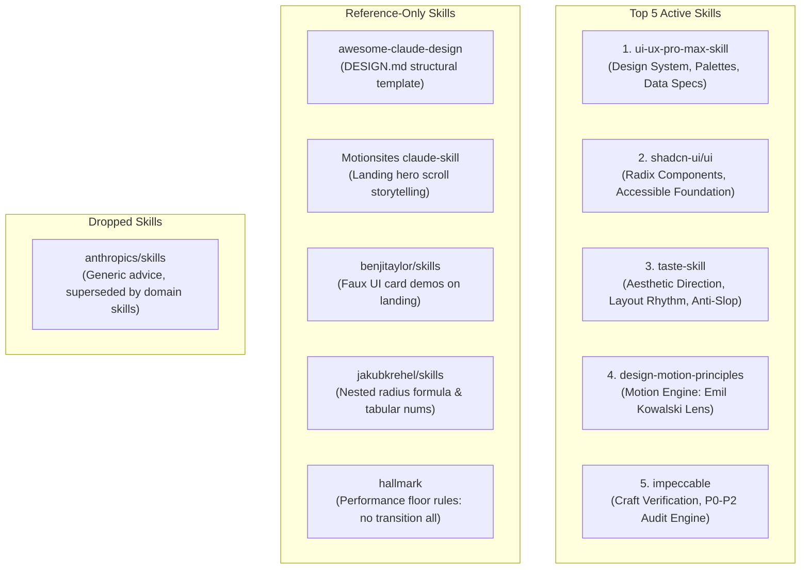

# HealthSync AI — Comprehensive Skill Audit & Architectural Plan (`SKILLS_PLAN.md`)

> **Document Type:** Principal UX/UI Designer & Design Engineer Audit  
> **Status:** Pending User Approval (Step A)  
> **Target Project:** HealthSync AI (`/c:/Users/ghosh/Desktop/HealthSync`)  
> **Output Path:** `/docs/SKILLS_PLAN.md`  

---

## 1. Executive Context & Healthcare Mission

HealthSync AI is a clinical document intelligence and personal health record platform. Its users include patients reviewing complex medical diagnoses, elderly individuals verifying dosages, and first responders accessing emergency profiles in critical situations. 

For this application, **"crazy good"** means:
* **Surgical craft & rhythm**: Impeccable optical alignment, calibrated data density, and effortless legibility.
* **Psychological safety & trust**: Zero gimmicks, zero neon colors, zero visual confusion, and zero ambiguous statuses.
* **Calm control**: Immediate answers, visible sources, clear medical disclaimers, and predictable interactions.

### Non-Negotiable Healthcare Safety Constraints
These constraints form the apex of our design hierarchy and override any external skill:
1. **Emergency Route Safety (`/emergency/[token]`)**: High-contrast, large-format type, mobile-first, zero animations, robust without heavy JavaScript.
2. **Accessible Status Representation**: Never communicate clinical status (Normal, Optimal, High, Critical) by color alone. Every badge must combine an explicit icon, descriptive text label, and WCAG AA-compliant background/text contrast.
3. **Motion Hygiene**: Full compliance with `prefers-reduced-motion`. In-app animations must be restrained, purpose-driven, and fast (150–250ms). Rich cinematic motion is permitted **only** on the marketing landing page (`/`).
4. **Internationalization & Multi-Script Resilience**: Resilient layouts accommodating English, Spanish, and Hindi (Devanagari script font fallbacks, flexible flex/grid containers, zero clipped text).
5. **Visible Medical Guardrails**: Non-intrusive, persistent disclaimers clarifying that HealthSync AI organizes records and never diagnoses or prescribes.
6. **Stack Discipline**: Next.js 15 App Router, React 19, Tailwind CSS 3.4 (no v4 syntax), Recharts, Lucide React, and Radix primitives.

---

## 2. In-Depth Audit of All 11 Skills

We have conducted a thorough source inspection of every repository cloned into `/skills-reference`:

```
skills-reference/
├── taste-skill/                # Leonxlnx/taste-skill
├── ui-ux-pro-max-skill/        # nextlevelbuilder/ui-ux-pro-max-skill
├── awesome-claude-design/      # VoltAgent/awesome-claude-design
├── design-motion-principles/   # kylezantos/design-motion-principles
├── benjitaylor-skills/         # benjitaylor/skills (stageshow)
├── claude-skill/               # Motionsites-AI/claude-skill
├── impeccable/                 # pbakaus/impeccable
├── anthropics-skills/          # anthropics/skills
├── hallmark/                   # Nutlope/hallmark
├── ui/                         # shadcn-ui/ui
└── jakubkrehel-skills/         # jakubkrehel/skills
```

---

### Skill 1: `Leonxlnx/taste-skill` (v2.5)
* **What it does:** An opinionated "anti-slop" frontend design and layout skill aimed at building bespoke, commercial-grade company interfaces at the level of Figma and x.ai. It enforces visual rhythm, equal content edges, real product UI, and quiet micro-interactions via automated verification gates (`gate.mjs`).
* **What it forces:**
  * *Rules:* Exactly one section per viewport height at 1440x900 on landing pages; equal left and right content margins; no captions under hero imagery; exactly one hero entrance animation per page; max one or two signature visual moments.
  * *Typography:* Distinctive non-default font pairing, strict scale hierarchy, sentence-case headlines.
  * *Colors:* Deep restraint, one primary brand color, dark/neutral backgrounds without artificial gradients.
  * *Animation:* 150–250ms button steps, 1.02x photo zoom on hover, card lift max 2px, no 3D tilt, no auto-advancing carousels.
* **Strengths:** Eliminates the "generic AI-generated template" appearance. Forces incredible discipline, whitespace balance, and realistic product mockups.
* **Risks for Healthcare:** Its strict landing rule of "one section per screen" (at 1440x900) can cause unnatural spacing on complex dashboard screens if misapplied to data-dense tables (e.g. lab biomarker tables). Must be restricted to marketing and macro-layout.

---

### Skill 2: `nextlevelbuilder/ui-ux-pro-max-skill`
* **What it does:** A massive design intelligence knowledge base containing 194 product reasoning profiles, 80 searchable UI styles (51 active), 74 curated font pairings, 130 UX guidelines, 105 curated icon sets, 25 chart patterns, and 22 technology stacks.
* **What it forces:**
  * *Rules:* Domain-specific design generation (healthcare profiles demand teal/slate palettes, high contrast, clean sans-serif typography, and zero gimmicks).
  * *Typography:* Pairing tables with fallback stacks (Inter, Plus Jakarta Sans, Geist, Roboto, and Noto Sans Devanagari).
  * *Colors:* Strict semantic token architectures (primitive, semantic, and component tokens in OKLCH/HSL).
  * *Components:* Deep token mapping for Tailwind CSS integration and accessible data tables.
* **Strengths:** The single best repository of healthcare-specific UX rules, accessible color palettes, biomarker chart guidelines, and Tailwind 3.4 tokens.
* **Risks for Healthcare:** Too expansive if uncurated. It offers 80 distinct styles (from brutalism to cyberpunk); we must explicitly pin it to the **Clinical Data-Dense / Clean Modern Health** profile.

---

### Skill 3: `VoltAgent/awesome-claude-design`
* **What it does:** A curated collection of 68+ production-ready `DESIGN.md` specifications designed to scaffold entire design systems (tokens, typography, component preview kits) into AI workflows.
* **What it forces:**
  * *Rules:* "Token, rule, and rationale in the same file." Explicit separation between primitive tokens, semantic tokens, and component variables.
  * *Aesthetic:* Mirrors prominent Silicon Valley SaaS design systems (Linear, Vercel, Stripe, Ramp, Apple).
* **Strengths:** Excellent structural blueprint for how to author a clean, actionable `/docs/DESIGN.md` that keeps coding agents on-system across runs.
* **Risks for Healthcare:** It does not contain code or interactive components—it is a meta-specification library. Cannot be an active functional skill.

---

### Skill 4: `kylezantos/design-motion-principles`
* **What it does:** An interaction and motion design system based on the published techniques of three premier design engineers: **Emil Kowalski** (restraint, speed, purposeful motion), **Jakub Krehel** (subtle production polish, physical springs), and **Jhey Tompkins** (delight, exploration). Operates in two modes: *Create* and *Audit*.
* **What it forces:**
  * *Rules:* Weighting by product context. For high-frequency productivity/health tools, the **Emil Kowalski lens** dominates: *"Should this animate at all? If yes, make it fast, purposeful, and imperceptible."*
  * *Motion Values:* Durations between 150ms and 240ms; transform and opacity transitions only; springs with zero overshoot on functional data elements; instant focus-visible indicators.
* **Strengths:** The definitive authority on when *not* to animate, preventing sickening or dizzying motion in medical tools. Provides exact spring stiffness, damping, and timing tables.
* **Risks for Healthcare:** Jhey Tompkins' "delight/playful" lens is inappropriate for medical record review; we must configure this skill to prioritize Emil Kowalski (primary) and Jakub Krehel (secondary), completely disabling Jhey's exploratory mode.

---

### Skill 5: `benjitaylor/skills` (Stageshow)
* **What it does:** A specialized skill for authoring believable miniature faux product UI, animated cursor walkthroughs, cropped browser frames, and bento cards for product marketing and documentation.
* **What it forces:**
  * *Rules:* "It reads as a real product, simplified to what the viewer needs, framed with intent, and every motion has a cause." Avoids over-packed wireframes and bland gray boxes.
* **Strengths:** Outstanding for building hero visual demonstrations (e.g., simulating a medical prescription turning into structured JSON on the landing page).
* **Risks for Healthcare:** Intended strictly for marketing illustrations and faux UI previews. Should never be used to construct real interactive application pages.

---

### Skill 6: `Motionsites-AI/claude-skill` (MotionSites Web Builder)
* **What it does:** A cinematic landing page builder that orchestrates high-impact hero sections, scroll-driven storytelling, layer choreography, and visual pacing.
* **What it forces:**
  * *Rules:* Identify mood in 3 words, build one unforgettable signature moment, establish clear z-index layering, and maintain strict clamp-based typography.
* **Strengths:** Provides the structure and narrative flow needed to make the landing page feel award-winning, trustworthy, and visually compelling.
* **Risks for Healthcare:** Highly cinematic and media-heavy. If applied to dashboard pages, it would create unnavigable visual noise. Must be confined strictly to the public landing page (`/`).

---

### Skill 7: `pbakaus/impeccable` (v4.10)
* **What it does:** A design director vocabulary and automated audit tool for AI coding agents. It provides specialized commands: `critique`, `audit`, `polish`, `bolder`, `quieter`, and `harden`.
* **What it forces:**
  * *Rules:* Adapts ambition to surface mode: on **Operate and Read** (dashboards, records), ambition shows as *precision, restraint, and familiar patterns*; on **Persuade** (landing page), ambition shows as *boldness and distinct point-of-view*.
  * *Quality Gate:* Checks optical alignment, contrast ratios, text truncation, and missing states (loading, empty, error).
* **Strengths:** Provides the exact evaluation vocabulary needed to audit screens for subtle flaws, misalignments, and contrast failures before shipping.
* **Risks for Healthcare:** If used in `bolder` or `overdrive` mode, it could push colors into aggressive, non-clinical palettes. Must be constrained to `critique`, `audit`, `polish`, and `harden`.

---

### Skill 8: `anthropics/skills`
* **What it does:** Anthropic's general-purpose example repository demonstrating Claude Skills across diverse tasks (algorithmic art, brand guidelines, MCP builders, doc coauthoring, webapp testing).
* **What it forces:** Broad multi-domain conventions, high-level design advice, and general prompt formulas.
* **Strengths:** Good foundational prompt engineering advice.
* **Risks for Healthcare:** Too generalized. Lacks specific design tokens, concrete motion values, or healthcare domain logic. It is thoroughly superseded by `taste-skill`, `ui-ux-pro-max`, and `design-motion-principles`.

---

### Skill 9: `Nutlope/hallmark` (v2.0)
* **What it does:** Enforces a rigid "anti-slop floor" on AI-generated interfaces, backed by the `sloplint.mjs` linter to catch common AI hallucinations.
* **What it forces:**
  * *Hard Floor Rules:* Every color and font must go through a `:root` token; never `transition: all`; never animate width/height/top/left; `overflow-x: clip` on html and body; never an invented metric or testimonial; never a label in tracked uppercase or small-caps; never middle-dot-joined metadata strings; never an eyebrow badge.
* **Strengths:** Outstanding defensive rules against CSS performance bugs (`transition: all` bans, `overflow-x: clip`).
* **Risks for Healthcare:** **Severely over-restrictive for clinical dashboards.** Rule #9 bans uppercase labels/table heads, and Rule #10 bans decorative status dots and middle-dot metadata strings. In medical UIs, table headers like `FASTING PLASMA GLUCOSE (mg/dL)`, status dots (green/amber/red indicators alongside text), and middle-dot separators (`Specimen: Blood · 08:30 AM`) are indispensable for scanability.

---

### Skill 10: `shadcn-ui/ui`
* **What it does:** The official, industry-standard component architecture for accessible, unstyled, composable UI primitives built on Radix UI and Tailwind CSS.
* **What it forces:**
  * *Rules:* Composable primitives copied directly into the project repository (`components/ui/`), owned by the developer, styled via `cn()` utility and CSS variables. Zero runtime lock-in.
  * *Accessibility:* Full keyboard navigation, ARIA attributes, focus rings, and screen-reader support out of the box.
* **Strengths:** The universal standard for accessible React/Next.js components. Fully compatible with Tailwind 3.4 and React 19.
* **Risks for Healthcare:** Default un-themed styling can feel generic if left as stock slate/zinc. Must be systematically restyled using our custom `DESIGN.md` clinical tokens.

---

### Skill 11: `jakubkrehel/skills`
* **What it does:** A comprehensive suite of specialized UI engineering micro-skills by Jakub Krehel (`better-motion`, `better-ui`, `better-typography`, `better-colors`, `better-accessibility`, `better-layout`).
* **What it forces:**
  * *Rules:* Exact numerical values: button press scale `0.96`, optical border radius formula (`outer_radius = inner_radius + padding`), strict contrast checking against WCAG 2.2, tabular figures (`font-variant-numeric: tabular-nums`) for numbers.
* **Strengths:** Unrivaled mathematical precision for UI polish, nested radii, and accessible forms.
* **Risks for Healthcare:** Redundant with `design-motion-principles` (which incorporates Jakub's motion rules) and `ui-ux-pro-max` (which provides full color palettes).

---

## 3. The Clash Matrix

When combining multiple specialized design skills, philosophical and technical contradictions inevitably arise. The matrix below identifies every core clash across these skills:

| Clash Area | Competing Skill Philosophies | Nature of the Contradiction |
| :--- | :--- | :--- |
| **Clash 1: Aesthetic & Anti-Slop Floor** | `taste-skill` vs `hallmark` vs `impeccable` | `taste-skill` aims for commercial, high-taste bespoke craft (Figma/x.ai bar). `hallmark` imposes a rigid negative floor that bans eyebrows, tracked caps, and middle-dots. `impeccable` scales ambition by mode (Operate vs Persuade). |
| **Clash 2: Motion Philosophy & Timing** | `design-motion-principles` (Emil Kowalski) vs `taste-skill` vs `Motionsites` | `design-motion-principles` (Emil) demands extreme restraint (150ms, no animation unless needed). `taste-skill` enforces looped micro-animations (cards lifting 2px, photos zooming, 2.5–4s card loops). `Motionsites` demands cinematic, immersive multi-layer scroll choreography. |
| **Clash 3: Metadata, Labels & Table Typography** | `hallmark` (Rule #9 & #10) vs `ui-ux-pro-max` / Clinical Standards | `hallmark` explicitly forbids tracked uppercase labels, small caps, eyebrow tags, and status dots. Clinical design standards *require* clear uppercase table headers (`REF RANGE`, `ANALYTE`), status indicators, and compact metadata pills for rapid triage. |
| **Clash 4: Component Construction** | `shadcn-ui/ui` vs Custom Scratch HTML/CSS (`taste-skill` / `Motionsites`) | `shadcn-ui` mandates composing modular Radix primitives with atomic Tailwind classes. `taste-skill` and `Motionsites` often write full-bleed, custom single-element layouts with bespoke CSS. |
| **Clash 5: Quality Audit & Verification** | `impeccable` (`critique`/`audit`) vs `hallmark` (`sloplint.mjs`) vs `design-motion-principles` audit | `impeccable` audits holistic design craft, hierarchy, and surface mode. `hallmark` runs a strict binary AST linter (`sloplint.mjs`) that fails builds on minor stylistic choices. `design-motion-principles` audits purely for motion overshoots and 60fps frame drops. |
| **Clash 6: Landing Page vs Clinical Application** | `Motionsites` / `benjitaylor/stageshow` vs In-App Health Records | `Motionsites` and `stageshow` are built for marketing spectacle and faux UI. In-app health tools (Document Review, Biomarker Analytics) require high-density, calm, zero-latency clinical truth. |

---

## 4. Clash Resolution & Winner Selections

For each clash identified above, we select exactly **ONE winner** for HealthSync AI and provide a concise, two-line justification. Losers are either demoted to *Reference-Only* or completely *Dropped*.

### Clash 1 Winner: `taste-skill` (Aesthetic Direction)
* **Justification:** `taste-skill` builds commercial-grade, confident interfaces with bespoke rhythm and real product UI without crippling essential data displays. `hallmark` is demoted because its aggressive blanket bans destroy standard clinical tables and status pills.
* *Losers:* `hallmark` (demoted to reference), `anthropics/skills` (dropped).

### Clash 2 Winner: `design-motion-principles` (Interaction & Motion Engine)
* **Justification:** Configured to the Emil Kowalski lens, it enforces the high-frequency speed and functional restraint required for healthcare safety, preventing user nausea or cognitive delay. `Motionsites` is demoted to reference-only for landing hero choreography.
* *Losers:* `Motionsites` (reference-only for landing), `jakubkrehel/skills` (absorbed).

### Clash 3 Winner: `ui-ux-pro-max-skill` (Design System, Tokens & Clinical Data)
* **Justification:** It provides deep, scientifically grounded clinical color palettes (teal/slate/amber/rose), strict WCAG AA contrast rules, and tabular analyte formatting essential for medical charts. `hallmark`'s anti-label rule is explicitly overridden.
* *Losers:* `hallmark` (overridden), `jakubkrehel/better-typography` (absorbed into ui-ux-pro-max).

### Clash 4 Winner: `shadcn-ui/ui` (Component Foundation)
* **Justification:** Fully tested, accessible Radix UI primitives guarantee screen-reader compatibility and keyboard navigation in Next.js 15 / React 19. Custom scratch components from marketing skills cannot meet healthcare accessibility standards.
* *Losers:* Scratch component generation from `taste-skill` / `Motionsites`.

### Clash 5 Winner: `impeccable` (Design Audit & Quality Gate)
* **Justification:** Its surface-aware vocabulary (`Operate` vs `Persuade`) allows rigorous craft auditing of clinical dashboards without triggering false-positive linter failures on legitimate medical UI patterns.
* *Losers:* `hallmark` `sloplint.mjs` (dropped due to rigid false positives).

### Clash 6 Winner: Strict Boundary Split (`taste-skill` + `shadcn` for App; `Motionsites` + `Stageshow` for Landing)
* **Justification:** In-app screens (Review, Dashboard, Analytics, Emergency) are governed 100% by `shadcn-ui`, `ui-ux-pro-max`, and `taste-skill` restraint. `Motionsites` and `stageshow` are permitted strictly on the public landing page hero and feature showcase.

---

## 5. Final Selection: The 5 Active Skills

To maintain absolute architectural clarity and avoid context window pollution, we select **EXACTLY 5 ACTIVE SKILLS**. The remaining 6 skills are categorized as *Reference-Only* or *Dropped*.



### The 5 Active Skills & Their Assigned Ownership:
1. **`ui-ux-pro-max-skill`** (Active System Data): Owns the clinical color palette (Teal/Slate/Amber/Rose), typography hierarchy, spacing scale, and Recharts biomarker guidelines.
2. **`shadcn-ui/ui`** (Active Component Library): Owns all atomic UI primitives (Buttons, Dialogs, Cards, Tables, Tabs, Selects, Toasts, Tooltips, Inputs) styled with our design tokens.
3. **`taste-skill`** (Active Aesthetic Lead): Owns visual taste, section pacing, whitespace balance, realistic clinical previews, and anti-slop restraint across all screens.
4. **`design-motion-principles`** (Active Motion Engine): Owns interaction physics, duration tables (150–240ms), spring parameters, and the `prefers-reduced-motion` implementation.
5. **`impeccable`** (Active Audit & Polish Gate): Owns the final quality control, dark-mode verification, contrast checking, and P0/P1/P2 issue ranking.

---

## 6. The Cherry-Pick Table

This table specifies the exact rules, files, and techniques extracted from each skill, what is explicitly ignored, and the build phase in which it is utilized:

| Skill | Take (Exact Rules / Sections / Files) | Ignore (Explicitly Banned) | Used in Phase |
| :--- | :--- | :--- | :--- |
| **`ui-ux-pro-max-skill`** *(Active)* | • Clinical color palettes (Teal 600 primary, Slate 900 base, Amber 500 warning, Rose 600 critical)<br>• Typography scale & pairing (Plus Jakarta Sans display + Inter body + Noto Sans Devanagari fallback)<br>• Recharts reference-band patterns & analyte table specs<br>• WCAG AA contrast matrix & 44px touch target rules | • Non-healthcare styles (Brutalism, Cyberpunk, Retro-futurism)<br>• Unchecked dark palettes that lower data legibility | **Step B** (Design System)<br>**Step C** (Components)<br>**Step D** (Screens) |
| **`shadcn-ui/ui`** *(Active)* | • Component primitives (`Button`, `Card`, `Input`, `Dialog`, `Sheet`, `Table`, `Tabs`, `Badge`, `Tooltip`, `Skeleton`, `Checkbox`, `Switch`)<br>• Radix UI accessibility bindings, keyboard focus traps, ARIA attributes<br>• `components.json` registry integration with `@aceternity` | • Stock default styling without clinical tokens<br>• Tailwind v4 syntax (must adapt to Tailwind 3.4) | **Step C** (Component Foundation)<br>**Step D** (Screens) |
| **`taste-skill`** *(Active)* | • Anti-slop layout rules: equal content edges, real product UI, zero empty ground<br>• One visual hero entrance on load (`data-enter`)<br>• Hover micro-interactions: card lift max 2px, button step, subtle border illumination<br>• Section rhythm: clear visual hierarchy without stacked cards inside cards | • Rigid "one section per screen" rule when applied to data-dense tables/dashboards<br>• Ban on captions (clinical image viewer requires metadata captions) | **Step B** (Design Direction)<br>**Step D** (Screens)<br>**Step E** (Landing) |
| **`design-motion-principles`** *(Active)* | • **Emil Kowalski lens**: "Should this animate at all?" — high-frequency restraint<br>• Interaction timings: 150ms for buttons, 200ms for menus, 250ms for modals<br>• CSS property constraint: animate `transform` and `opacity` only (never width/height)<br>• Springs with zero overshoot for functional clinical feedback | • Jhey Tompkins exploratory/playful lens<br>• Bouncing or playful springs on medical data displays<br>• Looping motion that distracts from reading lab values | **Step B** (Motion Tokens)<br>**Step F** (Micro-Interactions) |
| **`impeccable`** *(Active)* | • Surface-mode philosophy: *Operate and Read* for clinical tools, *Persuade* for landing<br>• Audit vocabulary: `critique`, `polish`, `harden`<br>• Multi-breakpoint verification (360px mobile, 768px tablet, 1280px desktop)<br>• Contrast, focus ring, and text-truncation checklist | • `overdrive` or `bolder` modes that inject excessive visual flair<br>• Automated screenshot commands that require unsupported CLI tools | **Step G** (Audit & Polish) |
| **`awesome-claude-design`** *(Reference)* | • Structural blueprint of `DESIGN.md` (token, rule, and rationale in one file)<br>• Study 2-3 clean, data-heavy, calm systems (Linear, Vercel, Stripe) | • Visual appearance, dark mode neon accents, or unverified color tokens | **Step B** (DESIGN.md creation) |
| **`Motionsites claude-skill`** *(Reference)* | • Hero storytelling structure for the landing page<br>• Scroll-reveal choreography and clamp-based display typography | • Cinematic video backgrounds on app pages<br>• Heavy JavaScript animations inside dashboard or review screens | **Step E** (Landing Page Only) |
| **`benjitaylor/skills`** *(Reference)* | • Faux UI techniques: simplified visual framing of an extracted prescription in the landing hero | • Any use inside real application screens or clinical review flows | **Step E** (Landing Hero Moment) |
| **`jakubkrehel/skills`** *(Reference)* | • Nested border radius formula: `outer_radius = inner_radius + padding`<br>• Tabular figures rule: `font-variant-numeric: tabular-nums` for all lab values | • Standalone skills that duplicate `design-motion-principles` or `ui-ux-pro-max` | **Step B** (Tokens)<br>**Step C** (Components) |
| **`hallmark`** *(Reference)* | • Technical performance floor: `overflow-x: clip`, never `transition: all`, instant `:focus-visible` | • Ban on tracked uppercase headers, eyebrow tags, status dots, and metadata strings<br>• `sloplint.mjs` execution | **Step B** (CSS Floor Rules) |
| **`anthropics/skills`** *(Dropped)* | • None | • Entire repository dropped (generic, superseded by dedicated domain skills) | Dropped |

---

## 7. Runtime Conflict Priority Order

When two or more rules, tokens, or components conflict during design and implementation, the agent must resolve the clash by strictly following this 5-level hierarchy:

```
┌────────────────────────────────────────────────────────────────────────┐
│ LEVEL 1: HEALTHCARE SAFETY NON-NEGOTIABLES                             │
│ • Emergency route (/emergency/[token]): 100% accessible, 0 animation   │
│ • Status badges: Icon + Text Label + Color (never color alone)          │
│ • WCAG AA contrast (≥ 4.5:1 text, ≥ 3.0:1 UI), 44px touch targets       │
│ • Respect prefers-reduced-motion everywhere                            │
│ • Visible medical disclaimer on all clinical and AI assistant views    │
│ • Multi-language resilience (English, Spanish, Hindi Devanagari)       │
└───────────────────────────────────┬────────────────────────────────────┘
                                    │ overrides
┌───────────────────────────────────▼────────────────────────────────────┐
│ LEVEL 2: HEALTHSYNC DESIGN SYSTEM TOKENS (/docs/DESIGN.md)             │
│ • Semantic color variables (--brand, --surface, --text, --status-*)    │
│ • Typography scale, weights, and tabular numbers for lab analytes      │
│ • Spacing, nested radius formula, elevation, and border tokens         │
│ • Motion duration & easing tokens (150ms-250ms, transform/opacity)     │
└───────────────────────────────────┬────────────────────────────────────┘
                                    │ overrides
┌───────────────────────────────────▼────────────────────────────────────┐
│ LEVEL 3: WINNER TASTE SKILL (`taste-skill` Anti-Slop Rules)            │
│ • Equal content margins and balanced whitespace                        │
│ • Real clinical product UI, never generic AI-made templates             │
│ • Maximum of one signature hero moment on landing                      │
│ • Restrained hover states (max 2px lift, subtle border lighting)       │
└───────────────────────────────────┬────────────────────────────────────┘
                                    │ overrides
┌───────────────────────────────────▼────────────────────────────────────┐
│ LEVEL 4: WINNER MOTION ENGINE (`design-motion-principles` Emil Kowalski)│
│ • Restraint first: animate only functional state changes               │
│ • Physical springs with zero overshoot on functional data controls     │
│ • Faster exits than entrances (e.g., 200ms in, 150ms out)              │
└───────────────────────────────────┬────────────────────────────────────┘
                                    │ overrides
┌───────────────────────────────────▼────────────────────────────────────┐
│ LEVEL 5: COMPONENT DEFAULTS & REFERENCE SKILLS                         │
│ • Default shadcn/ui styles, Radix fallback props, and reference guides │
└────────────────────────────────────────────────────────────────────────┘
```

---

## 8. Step A Completion Summary & Next Actions

1. **Audit Completed**: All 11 candidate skills have been systematically inspected, documented, and cataloged.
2. **Clashes Resolved**: Contradictions between marketing flair, rigid linters, and clinical safety have been settled with clear, defensible winner selections.
3. **Skill Count Pinned**: Exactly 5 active skills selected (`ui-ux-pro-max`, `shadcn-ui`, `taste-skill`, `design-motion-principles`, `impeccable`), keeping the execution focused and disciplined.
4. **No Code Modified**: In accordance with instructions, zero code or UI files have been altered in this step.

> [!IMPORTANT]
> **Awaiting User Approval:**  
> This concludes **STEP A — SKILL AUDIT**. I have stopped and am awaiting your explicit review and approval of `/docs/SKILLS_PLAN.md` before proceeding to **STEP B — DESIGN DIRECTION + SYSTEM** (`/docs/DESIGN.md`).
